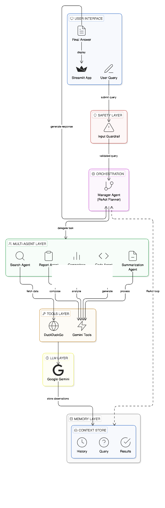

# Document-grounded backend (first migration slice)

The new FastAPI path is independent of the legacy Streamlit/CrewAI application
documented below. It accepts UTF-8 `.txt` and `.md` documents and returns cited
source excerpts, or abstains when it cannot produce a validated answer.

This deliberately small RAG implementation uses term-overlap retrieval, not
embeddings or a vector database. A typed, allowlisted `retrieve` call replaces
free-text action parsing in this path. Code selects the single retrieval tool;
there is no autonomous model planner. Each request runs at most one retrieval
and one generation. It cannot invoke legacy web search or code tools.

## Run the backend

Use Python 3.13 and a separate environment from the legacy application:

```sh
python3 -m venv .venv-backend
source .venv-backend/bin/activate
pip install -r requirements-backend.txt
export GEMINI_API_KEY='your-key'
export GEMINI_MODEL='gemini-2.5-flash'  # optional; this is the default
uvicorn backend.api:app --host 127.0.0.1 --port 8000
```

The backend reads environment variables directly; it does not load `.env` files.
Importing it or uploading text does not require credentials. Questions that
require a model abstain if credentials or the provider are unavailable.

Upload a raw text body (not multipart), then use its returned `document_id`:

```sh
curl -X POST 'http://127.0.0.1:8000/documents?filename=notes.txt' \
  -H 'Content-Type: text/plain' --data-binary @notes.txt
curl -X POST 'http://127.0.0.1:8000/questions' \
  -H 'Content-Type: application/json' \
  -d '{"question":"When is the launch?","document_ids":["ID_FROM_UPLOAD"]}'
```

The answer includes `abstained`, a machine-readable `reason`, `citations`, and
ordered `trace` events. Citations contain document/chunk IDs, filename, exact
quote, and zero-based Unicode character offsets `[start, end)` in the original
text. The answer consists of numbered excerpts; it does not synthesize prose.
Unknown IDs return 404; malformed requests return 422; unsupported media types
return 415; exceeded upload/corpus limits return 413.

## Boundaries and defenses

- Only explicitly requested document IDs are searched. Documents are chunked
  into 1,000-character spans with 100-character overlap; at most five matching
  chunks are considered. Whole chunks are admitted in retrieval order.
- The configured 8,192-token budget includes the complete serialized prompt
  (instructions, schema, question, source IDs, and admitted text), counted by the
  selected Gemini model. It reserves 1,024 output tokens, also enforced in the
  generation request. Counting failure causes abstention. There is no growing
  conversation history or automatic fallback model.
- Question and document content are serialized as untrusted JSON data. The
  model receives no tools, credentials, or prior requests. Tool calls and model
  outputs reject unknown fields. Every returned quote must occur in a supplied
  chunk; otherwise the entire answer abstains.
- These controls prevent execution and unsupported generated prose; they do
  not prove quotation relevance or make malicious source text trustworthy.
  Injection text can itself be quoted. Treat returned excerpts as untrusted
  text when rendering them. Lexical retrieval can miss paraphrases and
  character chunking can split sentences.
- The service is a local, single-user prototype: no authentication, persistent
  storage, or tenant isolation. Documents remain in process memory until restart
  (1 MB/file, 10 MB total, 100 documents). Use one worker. Selected text and the question go to
  Gemini. Do not expose this service publicly or upload sensitive documents
  without appropriate access and data-handling controls.
- Traces record retrieval counts, context budgets, and outcomes, not raw prompts,
  secrets, or hidden reasoning. Provider error text is not returned.

## Verify and evaluate

```sh
python -m pytest tests/test_backend.py tests/test_evals.py -q
python -m evals.run                       # offline, scripted pipeline checks
python -m evals.run --mode live           # explicitly uses Gemini and may cost money
```

`evals/cases.json` versions answerability, citation, injection, and scope fixtures.
Reports include per-case outcomes, dataset SHA-256, model ID, and context limits;
a failed case makes the command exit nonzero. Replay mode uses scripted outputs
and byte counts to test contracts. Its pass count is **not a model-quality
metric**. Live mode skips the two deliberately malformed model-output fixtures,
fails infrastructure errors, and checks exact expected excerpts on the remaining
small fixture set. Live model behavior is not deterministic even at temperature
zero, and a provider may update a model behind an ID. No live results are claimed.
Dependencies, including transitive dependencies, are pinned for repeatable setup.

The original `tests/` files still exercise the legacy path and may call external
services; the commands above intentionally select the new offline suite.

For Docker, build with `docker build -f Dockerfile.backend -t research-backend .`
and run with `docker run --rm -p 127.0.0.1:8000:8000 --env GEMINI_API_KEY research-backend`.
The existing Dockerfile continues to run Streamlit.

## Change map

- `backend/models.py`: strict API, tool-call, citation, and trace contracts.
- `backend/store.py`: bounded text ingestion, stable source spans, lexical retrieval.
- `backend/engine.py`: tool routing, prompt budgeting, quote validation, abstention.
- `backend/gemini.py`: lazy provider access, token counting, output cap.
- `backend/api.py`: upload and question HTTP endpoints with isolated app state.
- `evals/` and the new tests: offline behavior checks and explicit live evaluation.

---

## Legacy application

🧠 Autonomous AI Research & Implementation Assistant

This project is an agentic AI system that can understand a user query, decide how to solve it, and dynamically use multiple specialized agents to produce a final answer.

Unlike traditional AI applications that follow a fixed pipeline, this system uses a ReAct (Reason + Act) loop, allowing it to think step-by-step and choose actions intelligently.

Most AI systems today:
 Follow a fixed pipeline (search → summarize → output)
 Cannot adapt to different query types
 Treat all queries the same way

Our Solution

We built a multi-agent system where:
✔ The system decides WHAT to do (Planner)
✔ Specialized agents decide HOW to do it
✔ Tools execute the actual operations

This makes the system:
✔ Dynamic
✔ Context-aware
✔ Adaptive to different queries

🧠 Core Idea: ReAct-Based Agent System

The system follows a ReAct loop:
Thought → Action → Observation → Repeat → Final Answer

⚙️ How the System Works
Step-by-step flow:

1. User gives a query
2. Safety Guardrail (checks if query is according to policy)
3. Manager (Planner Agent) analyzes the query
4. Decides the next best action:
   - search
   - summarize
   - code
   - compare
   - report
5. Calls the corresponding agent
6. Agent uses its tool to perform the task
7. Result is stored in context
8. Manager re-evaluates and decides next step
9. Loop continues until task is complete
10. Final answer is generated using all collected information




🧩 Key Components :
🧠 Manager Agent (Planner) :
Central brain of the system
Uses LLM reasoning
Decides next action dynamically
Prevents unnecessary steps

🤖 Specialized Agents

Each agent has a single responsibility:

🔍 Search Agent → fetch external information.
🧾 Summarization Agent → simplify content.
💻 Code Agent → generate code.
📊 Comparison Agent → structured comparisons.
📝 Report Agent → final structured output.
🛠️ Tools (Execution Layer).

Agents use tools to perform actions:
SearchTool → DuckDuckGo.
LLM Tools → Gemini API.

🛡️ Safety Guardrail :
Filters unsafe or harmful queries .
Ensures responsible AI behavior.
Prevents misuse of the system.

🧠 Context Memory :

Stores:
- Query.
- Previous actions.
- Observations.
- Results.

This enables:
✔ Multi-step reasoning.
✔ Avoiding repeated actions.
✔ Context-aware decisions.

🔁 Example Execution:

Query:
"Compare RNN and LSTM"?

Execution:
Step 1:
Thought → Need comparison.
Action → compare.

Step 2:
Thought → Enough info.
Action → finish.


🖥️ User Interface:
Built with Streamlit
Sequential output (like ChatGPT)
Displays:
Final answer
Comparison / Code / Summary (if applicable)
Sources (if used)

🛠️ Tech Stack:
Python
Streamlit
Gemini API
DuckDuckGo Search
ReAct Architecture


⚙️ Setup & Installation:
🔧 Prerequisites:
Python 3.9+
Git
Internet connection (for API calls)

Installation : 
git clone https://github.com/your-username/your-repo.git .
cd AI_Research_Agent .

python -m venv venv
source venv/bin/activate      # Mac/Linux
venv\Scripts\activate         # Windows

pip install -r requirements.txt


🔑 API Key Setup

This project uses Google Gemini API

Step 1: Get API Key
Go to: https://ai.google.dev/
Generate API key
🌱 Environment Configuration

Create a .env file:
GEMINI_API_KEY=your_api_key_here

Run command : 
streamlit run app.py

🧪 Testing
✅ Unit Testing

Each agent can be tested independently:
pytest tests/test_agents.py


